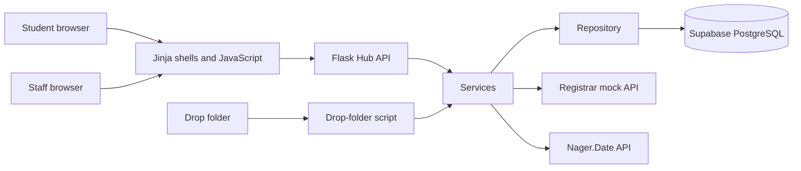
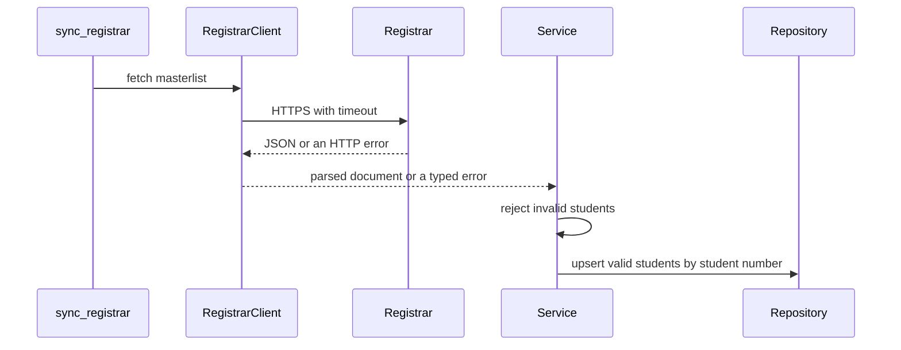
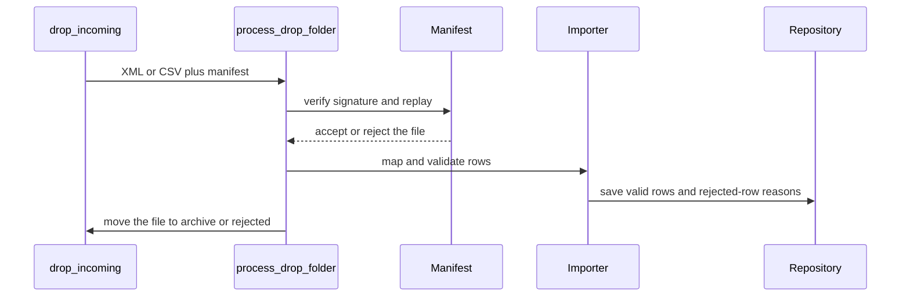
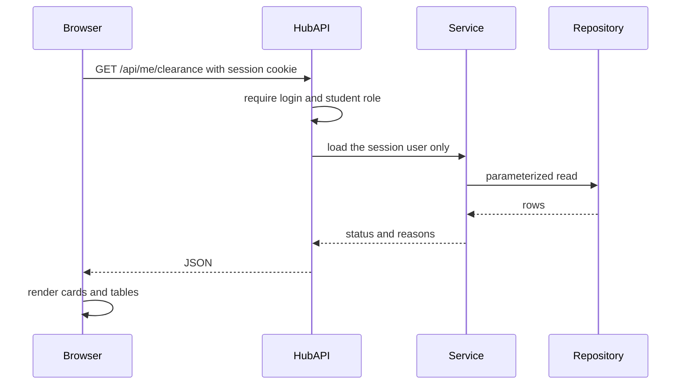
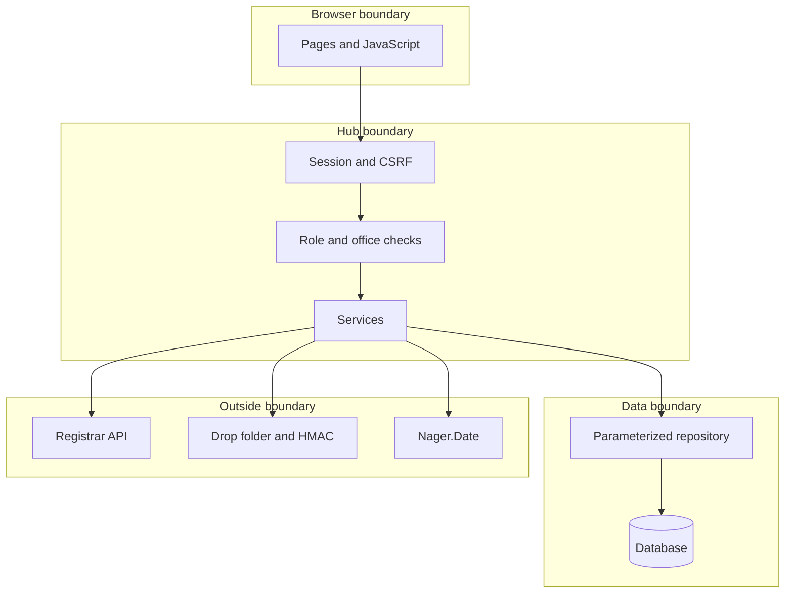

# DNSC e-Clearance Hub — Phase 2 Architecture

Status: architecture baseline. No application code in this phase.
This document follows [phase-01-requirements.md](phase-01-requirements.md).
Phase 3 environment setup is recorded in [phase-03-environment.md](phase-03-environment.md).

The Hub is one Flask application. It reads the Registrar, Library, and Accounting systems. It does not replace them. Students and staff use a browser. The browser talks only to the Hub.

## A. Objective

Describe the system before any code exists:

- Who is involved, and what problem the Hub solves.
- How the browser, Flask, the database, and the three office sources connect.
- How a record moves from an office file to a clearance status.
- Where secrets and permissions are enforced.
- Which folders later phases will fill.

## B. Stakeholders and the problem

| Who | What they do today | What the Hub gives them |
| --- | --- | --- |
| Student | Walks from office to office with a paper slip | One login, one status, HOLD reasons, and a verifiable digital slip |
| Library staff | Tracks unreturned books and fines in the Library system | Sees Library clearance only, places HOLD, or signs off |
| Accounting staff | Tracks tuition and other balances in the Accounting system | Sees Accounting clearance only, places HOLD, or signs off |
| Registrar | Keeps the official student masterlist | Stays the source of identity. The Hub copies it in. Registrar staff are not a Hub role in this version |

The paper process has no single status, no shared student identity across offices, and no record of who signed off. The Hub joins the three sources on one student number, computes clearance, and keeps an audit log.

Digital-transformation results this design is built to deliver:

- One online status instead of a trip to each office.
- HOLD reasons the student can read.
- The same student number across Registrar, Library, and Accounting.
- A record of every HOLD and sign-off.
- A signed slip that fails verification if the student is no longer cleared.
- Import files that are rejected with a reason when a row or a signature is bad.

Student Affairs and an admin role stay out of this version.

## C. System architecture



Four layers. Each layer may call only the layer beneath it.

| Layer | Responsibility | Later home |
| --- | --- | --- |
| Presentation | Layout, navigation, and screens. JavaScript calls the Hub API and draws the data. | `app/templates`, `app/static/js` |
| Hub API | Login, role checks, and JSON in and out. | `app/auth`, `app/api` |
| Services | Clearance rules, import validation, deadlines, slips, reports. | `app/services`, `app/importers`, `app/integrations` |
| Repository | Parameterized SQL. The only code that opens the database. | `app/db` |

The browser never opens the database and never calls Registrar, Nager.Date, or the drop folder.

### Frontend

Jinja renders the page shell: navigation, headings, and empty regions. After load, JavaScript requests JSON from the Hub and fills those regions. Clearance numbers are not printed by a template that queries the database.

Two shells:

- Student: profile, overall status, status per office, HOLD reasons, history, slip.
- Staff: students for the signed-in office, HOLD, sign-off, office records.

Shared pieces, built in Phase 5: color, type, buttons, inputs, cards, tables, badges, modals, and a sidebar that collapses on a phone.

### Backend

One Flask app, created with an application factory, split by Blueprints.

- `auth` handles login, logout, and the current user.
- `api` handles clearance, slips, and reports.
- Services hold the rules. Routes stay thin: read the session, check the role, call a service, return JSON or an error.

Authentication for the browser is a Flask server-side session:

- The cookie is HttpOnly.
- `Secure` is on when the app is not on localhost.
- `SameSite` is `Lax`.
- State-changing requests send a CSRF token.
- The session stores the user id and role. It does not store the password or the database URL.

The clearance slip uses a separate signed token. That token proves a slip. It is not the login session.

### Database

`DATABASE_URL` is the Supabase PostgreSQL connection string. Flask opens it on the server. The browser never receives it.

If the instructor later requires SQLite, only the repository module changes. Routes and pages stay the same.

Tables are not created in this phase. Names proposed in Phase 1 stay provisional until the Registrar sample, Library XML, and Accounting CSV are available. The repository methods below are the ones the services need. Column lists wait for Phase 4.

- Find a user by email, and store a password hash.
- Upsert a student from the Registrar payload, keyed by student number.
- Replace the current Library and Accounting rows for a student from one import.
- Read office clearance, HOLD reasons, and sign-off history.
- Record a HOLD or a sign-off, and append an audit row in the same transaction.
- Record an import run, each rejected row, and each accepted manifest id.
- Store and look up a clearance-slip token.

### Integrations

| Source | Direction | Transport | Hub module |
| --- | --- | --- | --- |
| Registrar mock API | Hub pulls the masterlist | HTTPS JSON, base URL from the environment | `app/integrations/registrar_client.py` |
| Library | Office drops a file | XML plus an HMAC manifest | `app/importers/library_xml.py` |
| Accounting | Office drops a file | CSV plus an HMAC manifest | `app/importers/accounting_csv.py` |
| Nager.Date | Hub pulls public holidays | HTTPS JSON, country `PH` | `app/integrations/holiday_client.py` |

Registrar paths, XML tags, CSV headers, and the manifest byte layout are not invented here. Those modules stay empty of sample field names until the instructor files are in the repo. The public Nager.Date holiday endpoint for a given year and `PH` is the planned holiday source. If the instructor names a different calendar source, only `holiday_client.py` changes.

Commands, not public web routes, run the jobs that have no admin screen:

- `python -m scripts.seed_users`
- `python -m scripts.sync_registrar`
- `python -m scripts.process_drop_folder`

Those scripts import the same services the API uses. Import logic is not copied into the script.

## D. Data flow

### 1. Registrar identity



A timeout, a non-JSON body, or a failed status code stops that run and writes a log. It does not delete students already stored.

### 2. Library and Accounting files



File rules:

- A bad signature or a replay moves the whole file to `drop/rejected` and writes a log. No rows are saved.
- A valid file can still contain bad rows. Bad rows go to the rejected-record log with a reason. Good rows are saved. The file then moves to `drop/archive`.
- The original file stays in `drop/incoming` until the database transaction commits.
- Each run appends a timestamped log under `drop/logs`.

Library blocking conditions, once the real XML confirms the fields, are an unreturned book or an unpaid fine. Accounting blocking conditions are an outstanding tuition or other balance. The exact field names wait for the sample files.

### 3. Clearance status

Required offices in this version are Library and Accounting. Registrar identifies the student and does not sign off, unless instructor question 4 says otherwise.

Each office status is one of:

| Status | When |
| --- | --- |
| `PENDING` | No blocking imported condition, and no staff sign-off yet |
| `HOLD` | A blocking imported condition exists, or a staff member placed a HOLD |
| `CLEARED` | A staff member of that office signed off, and no blocking imported condition is current |

A new import that adds a fine or a balance after a sign-off sets that office back to `HOLD`. The old sign-off stays in history.

Overall status:

| Overall | When |
| --- | --- |
| `HOLD` | Any required office is `HOLD` |
| `PENDING` | No office is `HOLD`, and at least one is `PENDING` |
| `CLEARED` | Every required office is `CLEARED` |

The student sees every reason. A staff member sees reasons for their own office.

### 4. Sign-off and HOLD

A staff request includes the session user. The service checks that the user role is `staff` and that the office on the request is the office stored on that user. Then it writes the office status, the history row, and the audit row in one transaction. A student calling the same URL is rejected before any write.

### 5. Browser read path



A student id in the query string is ignored for student routes. The id comes from the session.

### 6. Clearance slip

A slip is issued only when the overall status is `CLEARED`. The token is signed with the slip key from the environment. The QR code contains the verification URL.

`GET /api/verify/<token>` is public. It checks the signature, the expiry, and the current clearance. A valid signature on a student who has since gone to `HOLD` returns not cleared. The response uses a masked student id and does not include fines, titles, or balances.

### 7. Working-day deadlines

The holiday client requests Philippine public holidays for the needed year. Weekends and those holidays are excluded from the count.

Failure behavior:

- If the request fails and a previously saved holiday list exists, the deadline uses that list and the log records the failure.
- If the request fails and no list exists, the deadline is not calculated. The Hub does not assume there are no holidays.

What the deadline is attached to remains instructor question 6. The calculator is ready either way.

## E. Security boundaries



| Boundary | Rule |
| --- | --- |
| Browser | No database URL, no Supabase service-role key, no HMAC secret, no slip-signing key, no password. |
| Session | Login cookie only. Staff and student permissions are checked on the server for every API call. |
| Student data | A student receives only their own profile, clearance, history, and slip. |
| Staff data | A staff member receives only the office stored on their user row. |
| SQL | Every query is parameterized. User text is never concatenated into SQL. |
| Imports | The manifest is verified before parse. Tampered and replayed files are rejected. Accepted manifest ids are stored. |
| Slip | Signed and expired tokens fail. Verification does not bring a student back to `CLEARED`. |
| Reports | Exports that leave the office view show a masked student id. |
| Secrets | `.env` is local and gitignored. `.env.example` lists the keys with empty values. |
| Errors | The client receives a short message and a status code. The server log receives the detail. |
| Input | Emails, roles, offices, and status values are checked against an allow-list. |

Environment keys this design expects. Values stay empty in the example file.

- `SECRET_KEY` for the Flask session
- `DATABASE_URL`
- `REGISTRAR_BASE_URL` and whatever credential name the instructor documents
- `HMAC_SECRET` for import manifests
- `SLIP_SIGNING_KEY`
- `SEED_STUDENT_EMAIL`, `SEED_STUDENT_PASSWORD`, `SEED_STAFF_EMAIL`, `SEED_STAFF_PASSWORD`, `SEED_STAFF_OFFICE`

Demo email addresses and passwords from Phase 1 are loaded only through those seed variables. They are not written into Python, templates, or this architecture note.

## F. Hub API surface

These are the Hub's own routes. They are not the Registrar's routes. Request bodies are specified in the phase that implements each route.

| Method and path | Who | Purpose |
| --- | --- | --- |
| `POST /api/auth/login` | Public | Start a session |
| `POST /api/auth/logout` | Signed in | End the session |
| `GET /api/auth/me` | Signed in | Current user and role |
| `GET /api/me/profile` | Student | Own profile |
| `GET /api/me/clearance` | Student | Overall status, office status, HOLD reasons |
| `GET /api/me/clearance/history` | Student | Own history |
| `POST /api/me/slip` | Student | Issue a slip when overall status is `CLEARED` |
| `GET /api/verify/<token>` | Public | Check a slip. Masked id. Limited fields |
| `GET /api/office/students` | Staff | Students for the signed-in office |
| `GET /api/office/students/<student_number>` | Staff | One student in that office |
| `POST /api/office/students/<student_number>/hold` | Staff | HOLD with a reason |
| `POST /api/office/students/<student_number>/signoff` | Staff | Sign off that office |
| `GET /api/office/reports.csv` | Staff | Office report |
| `GET /api/office/reports.json` | Staff | Office report |

Unknown Registrar paths stay in `registrar_client.py` as named operations (`fetch_masterlist`) until the mock API document arrives. They are not published as Hub routes.

## G. Folder layout

Empty folders and packages are created in Phase 3, not in this phase. This is the map.

```text
DNSC_e-Clearance_Hub/
  app/
    __init__.py                      # create_app
    config.py                        # reads the environment
    extensions.py                    # session, CSRF, database selection
    auth/
      routes.py                      # login, logout, me
    api/
      clearance.py                   # student and staff clearance routes
      slips.py                       # issue and verify
      reports.py                     # CSV and JSON
    services/
      clearance_service.py           # office and overall status
      slip_service.py
      report_service.py
      deadline_service.py
    integrations/
      registrar_client.py
      holiday_client.py
    importers/
      manifest.py                    # HMAC and replay
      library_xml.py
      accounting_csv.py
    db/
      repository.py                  # method names both engines implement
      sqlite_repo.py
      postgres_repo.py
    templates/
      base.html
      auth/login.html
      student/dashboard.html
      staff/dashboard.html
    static/
      css/app.css                    # built Tailwind file
      js/api.js
      js/login.js
      js/student-dashboard.js
      js/staff-dashboard.js
  assets/css/input.css               # Tailwind source
  scripts/
    seed_users.py
    sync_registrar.py
    process_drop_folder.py
  drop/
    incoming/
    archive/
    rejected/
    logs/
  tests/
  docs/
    phase-01-requirements.md
    phase-02-architecture.md
  .env.example
  .gitignore
  requirements.txt
  package.json                       # Tailwind CLI only
  tailwind.config.js
```

Phase 3 creates this skeleton, the virtual environment, Tailwind, Git ignores, and a one-page Flask check. It does not implement login or imports.

## H. Decisions locked by this phase

- Flask sessions for browser login. Signed tokens for slips only.
- Supabase PostgreSQL is the database. Flask uses the connection string on the server.
- A later SQLite requirement changes only the repository module.
- Drop-folder processing, Registrar sync, and user seed are command-line scripts.
- Library and Accounting are the sign-off offices until the instructor says otherwise.
- Holiday failure never pretends that a missing calendar means a normal working day.
- A later HOLD invalidates an already issued slip.

## I. Completion checklist

- Stakeholders, the paper-process problem, and the digital-transformation results are stated.
- The architecture diagram shows the browser, the Hub, the database, and the three outside sources.
- Student, import, and slip flows are traceable.
- Security boundaries keep secrets and the database on the server.
- The folder layout names the file each later phase will add.
- No Flask app, dependency, or database table was created.

Confirm this document before Phase 3.
