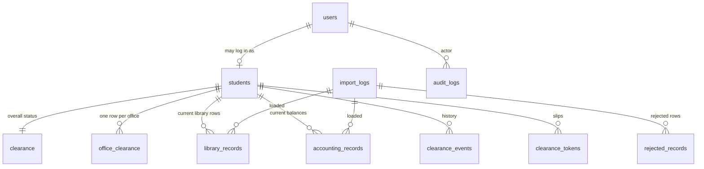

# DNSC e-Clearance Hub — Phase 4 Database Design

Status: tables created on Supabase PostgreSQL. Phase 5 has not started.

This design follows [phase-02-architecture.md](phase-02-architecture.md). The Registrar payload, Library XML, and Accounting CSV are still unknown, so source-specific names stay in `source_payload` until those files arrive. The columns below are the Hub's own facts, taken from the project brief.

## Engine

The database is Supabase PostgreSQL. Flask connects on the server with `DATABASE_URL`. The browser never receives that URL, the database password, or the Supabase service-role key.

Use the URI from the Supabase dashboard: Project Settings, Database, Connection string. Choose the direct connection or the session pooler. Paste it into `.env` as `DATABASE_URL`. The app adds `sslmode=require` when the URI does not already set it.

Dates are `TIMESTAMPTZ` in UTC. Flags are `BOOLEAN`. Money is `BIGINT` centavos, never a floating-point number. Original source rows are `JSONB`.

## How the records fit together

Registrar data lands in `students`. Library XML lands in `library_records`. Accounting CSV lands in `accounting_records`. Those three meet on `students.student_number`. `office_clearance` is the Library or Accounting decision. `clearance` is the single overall status, saved in the same transaction as the office rows so the two cannot disagree.

`office_records` from the early name list is not a table. It would copy `library_records` and `accounting_records`.

## Tables

### users

Purpose: login accounts for a student or a staff member.

| Column | PostgreSQL type | Keys and rules |
| --- | --- | --- |
| `id` | BIGINT | Primary key, identity |
| `email` | TEXT | Required, unique, compared without case |
| `password_hash` | TEXT | Required. A PBKDF2 or bcrypt hash, never the password |
| `role` | TEXT | Required. `student` or `staff` |
| `office` | TEXT | `library` or `accounting` for staff. Empty for a student |
| `created_at` | TIMESTAMPTZ | Required UTC timestamp |

A student row must have an empty office. A staff row must have an office. Demo accounts are inserted by the Phase 6 seed script, not by this design.

### students

Purpose: one official student, joined to Library and Accounting by student number. The login is optional because the masterlist can arrive before that student has a password.

| Column | PostgreSQL type | Keys and rules |
| --- | --- | --- |
| `id` | BIGINT | Primary key, identity |
| `student_number` | TEXT | Required, unique. The join key. Rename this column if the Registrar sample uses another name |
| `user_id` | BIGINT | Optional, unique, foreign key to `users.id`. If the login is removed, this becomes empty and the student row stays |
| `display_name` | TEXT | Required. The name shown in the Hub |
| `registrar_payload` | JSONB | Required object. The original Registrar record until its fields are mapped |
| `last_synced_at` | TIMESTAMPTZ | Optional UTC timestamp of the last successful sync |

### import_logs

Purpose: one run of the Registrar sync or one drop-folder file.

| Column | PostgreSQL type | Keys and rules |
| --- | --- | --- |
| `id` | BIGINT | Primary key, identity |
| `source` | TEXT | Required. `registrar_api`, `library_xml`, or `accounting_csv` |
| `filename` | TEXT | Optional. Empty for the Registrar API |
| `manifest_id` | TEXT | Optional. Present for a signed drop-folder file |
| `file_sha256` | TEXT | Optional hash of the file bytes |
| `status` | TEXT | Required. `accepted` or `rejected` |
| `rows_accepted` | INTEGER | Required, zero or more |
| `rows_rejected` | INTEGER | Required, zero or more |
| `message` | TEXT | Required. Short result, including a reject reason for the whole file |
| `created_at` | TIMESTAMPTZ | Required UTC timestamp |

An accepted `manifest_id` cannot be imported again. That is the replay rule. A rejected manifest may be submitted again after the file is fixed. The exact signature bytes still wait for the instructor's manifest format.

### rejected_records

Purpose: one invalid row inside a file or API page that was otherwise processed. The rest of the file can still be accepted.

| Column | PostgreSQL type | Keys and rules |
| --- | --- | --- |
| `id` | BIGINT | Primary key, identity |
| `import_log_id` | BIGINT | Required foreign key to `import_logs.id` |
| `student_number` | TEXT | Optional, when the bad row contained one |
| `row_number` | INTEGER | Optional line number in the source file |
| `reason` | TEXT | Required |
| `raw_row` | TEXT | Required. The original row, so the reason can be checked |
| `created_at` | TIMESTAMPTZ | Required UTC timestamp |

### library_records

Purpose: the current Library import for a student. Borrowed books, unreturned books, and unpaid fines from the brief. A new successful import for that student replaces these rows. Older status changes stay in `clearance_events`, not here.

| Column | PostgreSQL type | Keys and rules |
| --- | --- | --- |
| `id` | BIGINT | Primary key, identity |
| `student_id` | BIGINT | Required foreign key to `students.id` |
| `import_log_id` | BIGINT | Required foreign key to `import_logs.id` |
| `title` | TEXT | Required. Book title or fine label. The XML tag is mapped in Phase 8 |
| `is_unreturned` | BOOLEAN | Required |
| `fine_cents` | BIGINT | Required, zero or more |
| `is_blocking` | BOOLEAN | Required |
| `source_payload` | JSONB | Required. The original XML item |
| `created_at` | TIMESTAMPTZ | Required UTC timestamp |

A row blocks clearance only when the book is unreturned or the fine is greater than zero. A borrowed book that was returned, with no fine, can be stored and does not block.

### accounting_records

Purpose: the current unpaid tuition or other balance for a student. A new successful import replaces these rows.

| Column | PostgreSQL type | Keys and rules |
| --- | --- | --- |
| `id` | BIGINT | Primary key, identity |
| `student_id` | BIGINT | Required foreign key to `students.id` |
| `import_log_id` | BIGINT | Required foreign key to `import_logs.id` |
| `description` | TEXT | Required. For example tuition or another charge. The CSV header is mapped in Phase 9 |
| `balance_cents` | BIGINT | Required, greater than zero |
| `is_blocking` | BOOLEAN | Required, and must be true |
| `source_payload` | JSONB | Required. The original CSV row |
| `created_at` | TIMESTAMPTZ | Required UTC timestamp |

A zero balance is not stored. No accounting row means Accounting has no blocking balance from the latest import.

### office_clearance

Purpose: the Library or Accounting decision for one student. Two rows per student, one for each office.

| Column | PostgreSQL type | Keys and rules |
| --- | --- | --- |
| `id` | BIGINT | Primary key, identity |
| `student_id` | BIGINT | Required foreign key to `students.id` |
| `office` | TEXT | Required. `library` or `accounting` |
| `status` | TEXT | Required. `PENDING`, `HOLD`, or `CLEARED` |
| `hold_reason` | TEXT | Required when status is `HOLD`. Empty otherwise |
| `signed_off_by` | BIGINT | Optional foreign key to `users.id`. Required when status is `CLEARED` |
| `signed_off_at` | TIMESTAMPTZ | Required when status is `CLEARED`. Empty while `PENDING` |
| `updated_at` | TIMESTAMPTZ | Required UTC timestamp |

`student_id` and `office` together are unique. `PENDING` has no sign-off. `CLEARED` has a staff user and a time, and no hold reason. `HOLD` always has a reason. A later import that adds a fine or a balance sets that office back to `HOLD`. The previous sign-off remains in `clearance_events`.

### clearance

Purpose: the overall status for one student. One row per student. The primary key is `student_id`.

| Column | PostgreSQL type | Keys and rules |
| --- | --- | --- |
| `student_id` | BIGINT | Primary key and foreign key to `students.id` |
| `overall_status` | TEXT | Required. `PENDING`, `HOLD`, or `CLEARED` |
| `updated_at` | TIMESTAMPTZ | Required UTC timestamp |

The service writes this row from the office rows: `HOLD` if either office is `HOLD`, `CLEARED` only when both are `CLEARED`, otherwise `PENDING`.

### clearance_events

Purpose: the history a student can read. Sign-off, hold, import change, and slip issued.

| Column | PostgreSQL type | Keys and rules |
| --- | --- | --- |
| `id` | BIGINT | Primary key, identity |
| `student_id` | BIGINT | Required foreign key to `students.id` |
| `office` | TEXT | Optional. `library`, `accounting`, or empty for a slip |
| `action` | TEXT | Required. `hold`, `signoff`, `import`, or `slip_issued` |
| `reason` | TEXT | Required. May be an empty string |
| `actor_user_id` | BIGINT | Optional foreign key to `users.id`. Empty when the actor is an import |
| `created_at` | TIMESTAMPTZ | Required UTC timestamp |

### audit_logs

Purpose: the security record of holds and sign-offs. This is separate from the student history. The student history is the story of the clearance. The audit log is who performed the action.

| Column | PostgreSQL type | Keys and rules |
| --- | --- | --- |
| `id` | BIGINT | Primary key, identity |
| `actor_user_id` | BIGINT | Optional foreign key to `users.id` |
| `action` | TEXT | Required |
| `student_id` | BIGINT | Optional foreign key to `students.id` |
| `office` | TEXT | Optional. `library` or `accounting` |
| `detail` | TEXT | Required |
| `created_at` | TIMESTAMPTZ | Required UTC timestamp |

A hold or a sign-off writes one `clearance_events` row and one `audit_logs` row in the same transaction.

### clearance_tokens

Purpose: issued digital slips. The database stores the hash of the token. The raw token is what the QR code contains.

| Column | PostgreSQL type | Keys and rules |
| --- | --- | --- |
| `id` | BIGINT | Primary key, identity |
| `student_id` | BIGINT | Required foreign key to `students.id` |
| `token_hash` | TEXT | Required, unique |
| `issued_at` | TIMESTAMPTZ | Required UTC timestamp |
| `expires_at` | TIMESTAMPTZ | Required UTC timestamp |
| `revoked_at` | TIMESTAMPTZ | Optional. Set when a later hold makes the slip invalid |

Verification checks the signature, the hash, the expiry, and the current overall status. A stored token does not keep a student cleared.

## Relationships

- A user has at most one student profile. Staff users have none.
- A student has one overall clearance row, two office rows, and any number of current library rows, accounting rows, events, and tokens.
- An import log owns the source rows and the rejected rows it produced.
- Staff identity on a sign-off points at `users`. Removing a staff account is refused while a sign-off still names that user.
- Indexes for lookup: `students.student_number`, `library_records.student_id`, `accounting_records.student_id`, `clearance_events.student_id`, `audit_logs.student_id`, and the accepted-manifest unique index.

## What is deliberately not locked

These names are remapped in Phases 7, 8, and 9 if the samples differ. They are not invented XML tags or API fields.

- The Registrar's name for `student_number` and `display_name`.
- The XML tags that fill `title`, `is_unreturned`, and `fine_cents`.
- The CSV headers that fill `description` and `balance_cents`.
- The manifest's id and signature layout.

`registrar_payload` and `source_payload` keep the original record so a mapping change does not throw data away.

## What was created

`app/db/schema.sql` is the PostgreSQL definition of these tables. `python -m app.db.migrate` creates them once. A second run reports `already-applied`.

The live database has these 11 empty tables. Constraint tests inserted rows and rolled them back, so no test students remain. A staff user must have an office, a student user must not, email is unique regardless of case, a library row must point at a real import, a `CLEARED` office row must name who signed off, and an accepted manifest id cannot be imported twice.

Phase 5, the visual design system, starts when you confirm these tables.
